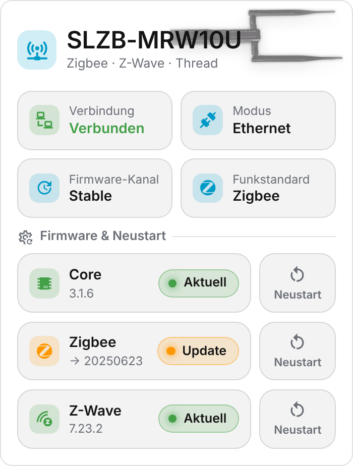

  

# SLZB Card

**English** | [Deutsch](https://github.com/BeGiBue/home-assistant-slzb-card#deutsch)

## English

Overview card for the **SMLIGHT SLZB-MRW10U** (PoE device with Zigbee, Z-Wave and Thread) in Home Assistant.

### Features

- Connection, connection mode, firmware channel and radio protocol at a glance
- Firmware status for core, radio module and Z-Wave
- Restart buttons with a second-tap confirmation
- Built-in device image, or your own image URL
- Follows light/dark mode and themes; works on phone, tablet and desktop

The card is shown in German when Home Assistant is set to German, and in English otherwise.

### Requirements

- The SMLIGHT integration must already provide the status, update and button entities; the card does not connect to the device itself.
- The default entity IDs are examples and must match your installation.

Independent community project, not affiliated with SMLIGHT or Home Assistant. Brand and product names belong to their respective owners. License: [AGPL-3.0-only](https://github.com/BeGiBue/home-assistant-slzb-card/blob/main/LICENSE).

## Deutsch

[English](https://github.com/BeGiBue/home-assistant-slzb-card#english) | **Deutsch**

Übersichtskarte für den **SMLIGHT SLZB-MRW10U** (PoE-Gerät mit Zigbee, Z-Wave und Thread) in Home Assistant.

### Funktionen

- Verbindung, Verbindungsmodus, Firmware-Kanal und Funkstandard auf einen Blick
- Firmware-Status für Core, Funkmodul und Z-Wave
- Neustart-Buttons mit Bestätigung durch zweites Tippen
- Eingebettetes Gerätebild oder eigene Bild-URL
- Passt sich Light-/Dark-Mode und Themes an, läuft auf Handy, Tablet und Desktop

Die Karte erscheint auf Deutsch, wenn Home Assistant auf Deutsch eingestellt ist, sonst auf Englisch.

### Voraussetzungen

- Die SMLIGHT-Integration muss die Status-, Update- und Button-Entitäten bereitstellen; die Karte verbindet sich nicht selbst mit dem Gerät.
- Die voreingestellten Entity-IDs sind Beispiele und müssen zur eigenen Installation passen.

Unabhängiges Community-Projekt, nicht mit SMLIGHT oder Home Assistant verbunden. Marken und Produktnamen gehören ihren jeweiligen Rechteinhabern. Lizenz: [AGPL-3.0-only](https://github.com/BeGiBue/home-assistant-slzb-card/blob/main/LICENSE).
